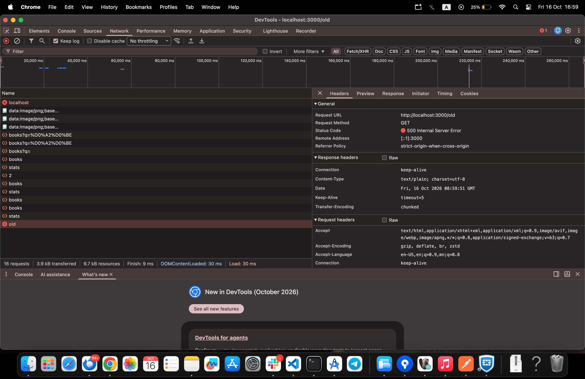

# BUG-01: Footer дахь «Хуучин хувилбар» холбоосыг дарахад 500 Internal Server Error гарч, хуучин хувилбар нээгдэхгүй

Орчин: Уншлагын жагсаалт v2.0, Google Chrome 154, macOS 15.6, curl 8.7.1, 2026-10-16

Урьдчилсан нөхцөл: node app.js-ийг шинээр асаасан (анхны 3 ном)

## Дахин гаргах алхам

1. Хөтөчөөр http://localhost:3000 хаягийг нээнэ.
2. Хуудасны доод хэсэгт (footer) байгаа «Хуучин хувилбар» холбоосыг дарна.
3. Терминалд `curl -i http://localhost:3000/old` командыг ажиллуулна.

Хүлээгдэж байсан: Спецификаци — «бүх хуудас, линк ажиллана». «Хуучин хувилбар» холбоос дарахад аппын хуучин хувилбарын хуудас нээгдэх ёстой.

Бодит үр дүн: Хөтөч зөвхөн «Internal Server Error» гэсэн текст харуулна. curl-ийн гаралт `HTTP/1.1 500 Internal Server Error`, `Content-Type: text/plain; charset=utf-8`, бие нь `Internal Server Error`.

Ноцтой байдал: Major — хэрэглэгчид харагдаж байгаа холбоос огт ажиллахгүй, серверийн алдаа гаргана. Үндсэн функцэд (нэмэх, хайх, устгах) нөлөөлөхгүй тул Critical биш.

Хавсралт: screenshots/bug-01.png (UI) · evidence/bug-01-curl.txt (API)

Олдсон аялал: Prior Version
