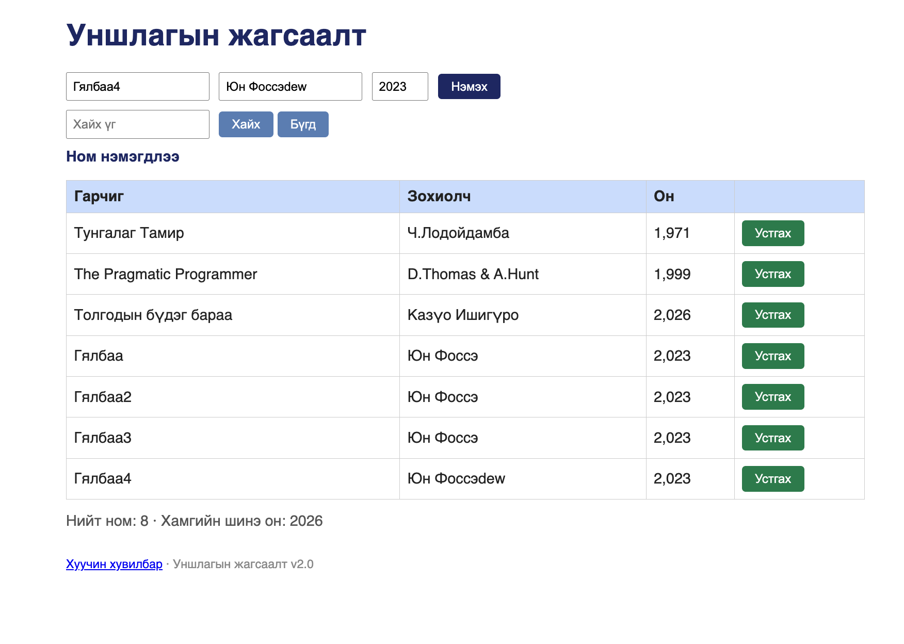

# BUG-02: Статистик хэсгийн «Нийт ном» нь хүснэгтэд байгаа номын тооноос үргэлж 1-ээр илүү харагдана

Орчин: Уншлагын жагсаалт v2.0, Google Chrome 154, macOS 15.6, curl 8.7.1, 2026-10-16

Урьдчилсан нөхцөл: node app.js-ийг шинээр асаасан (анхны 3 ном)

## Дахин гаргах алхам

1. Хөтөчөөр http://localhost:3000 хаягийг нээнэ.
2. Хүснэгтэд байгаа мөрийн тоог тоолно (3 мөр: «Тунгалаг Тамир», «Clean Code», «The Pragmatic Programmer»).
3. Хүснэгтийн доорх статистикийн мөрийг харна.
4. «Clean Code» мөрийн «Устгах» товчийг дарна.
5. Хүснэгтийн мөрийн тоо болон статистикийг дахин харна.
6. Терминалд `curl -i http://localhost:3000/api/stats` командыг ажиллуулна.

Хүлээгдэж байсан: Эрүүл ухаан — «Нийт ном» нь жагсаалтад байгаа номын тоотой тэнцүү байна: 2-р алхамд «Нийт ном: 3», 5-р алхамд «Нийт ном: 2».

Бодит үр дүн:  «Нийт ном: 4 · Хамгийн шинэ он: 2008» (3 мөр байхад). 5-р алхамд 2 мөр байхад «Нийт ном: 3». API нь `HTTP/1.1 200 OK`, `{"total":3,...}` гэж буцаана — алдаа серверийн `/api/stats` дээр байна. Ном нэмэх, устгах бүрт тоо зөв өөрчлөгдөх ч үргэлж +1 илүү.

Ноцтой байдал: Major — аппын харуулж буй статистик өгөгдөл үргэлж буруу. Хэрэглэгч номын тоонд итгэх боломжгүй.

Хавсралт: screenshots/bug-02.png, screenshots/search-stats.png (UI) · evidence/bug-02-curl.txt (API)

Олдсон аялал: Fed-Ex
