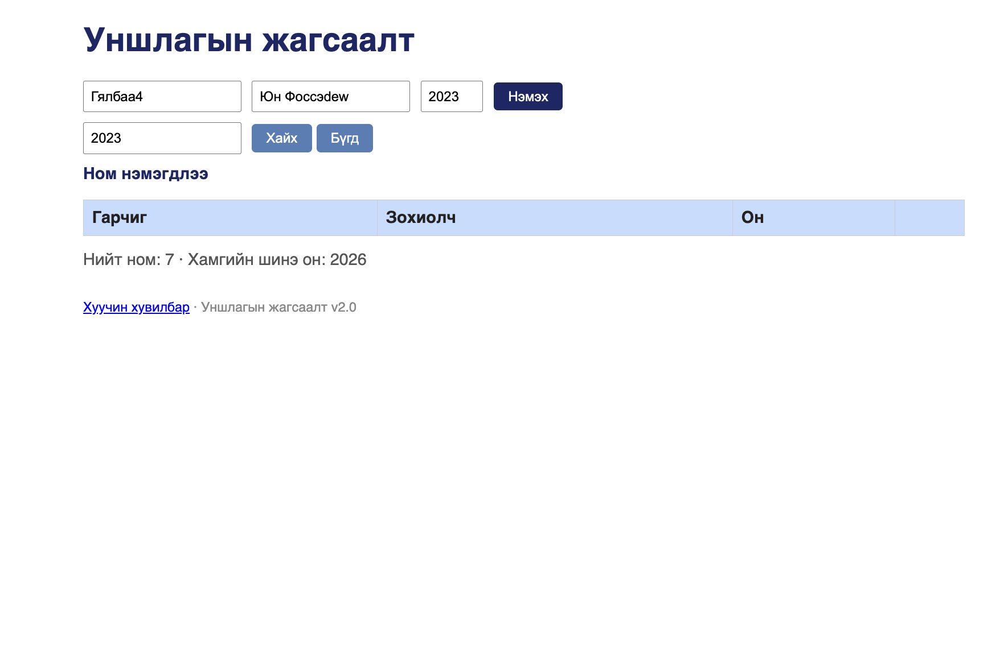

# BUG-03: Оноор хайхад жагсаалтад байгаа ном олдохгүй, хоосон үр дүнд «олдсонгүй» гэх мессеж гарахгүй

Орчин: Уншлагын жагсаалт v2.0, Google Chrome 154, macOS 15.6, curl 8.7.1, 2026-10-16

Урьдчилсан нөхцөл: node app.js-ийг шинээр асаасан (анхны 3 ном)

## Дахин гаргах алхам

1. Хөтөчөөр http://localhost:3000 хаягийг нээнэ. Хүснэгтэд «Тунгалаг Тамир» номын "Он" баганад 1971 он харагдаж байгааг шалгана.
2. «Хайх үг» талбарт `1971` гэж бичнэ.
3. «Хайх» товчийг дарна.
4. Терминалд `curl -i "http://localhost:3000/api/books?q=1971"` командыг ажиллуулна.

Хүлээгдэж байсан: Эрүүл ухаан — хүснэгтэд харагдаж байгаа Он баганаар хайхад «Тунгалаг Тамир» ном олдох ёстой. Хэрэв оноор хайх боломжгүй бол ядаж «Ном олдсонгүй» гэх мэт мессеж гарах ёстой.

Бодит үр дүн: Хүснэгт бүрэн хоосон болно, ямар ч мессеж гарахгүй (хэрэглэгч хайлт ажилласан эсэхийг мэдэхгүй). API нь `HTTP/1.1 200 OK`, `[]` буцаана — хайлт зөвхөн Гарчиг, Зохиолч дээр хийгддэг.

Ноцтой байдал: Minor — номыг гарчиг эсвэл зохиолчоор нь хайж олох боломжтой. Оноор хайх ёстой эсэх шаардлага тодорхойгүй (session-report-ийн асуулт, 17:04).

Хавсралт: screenshots/bug-03.png (UI) · evidence/bug-03-curl.txt (API)

Олдсон аялал: Fed-Ex
