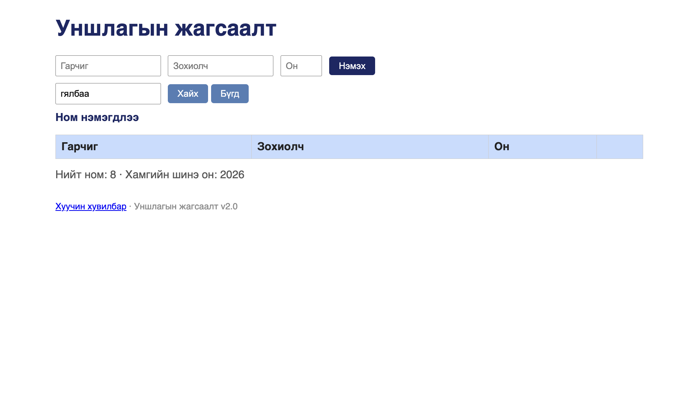

# BUG-04: Хайлт том/жижиг үсэг ялгадаг тул «clean» гэж хайхад «Clean Code» ном олдохгүй

Орчин: Уншлагын жагсаалт v2.0, Google Chrome 154, macOS 15.6, 2026-10-16

Урьдчилсан нөхцөл: node app.js-ийг шинээр асаасан (анхны 3 ном)

## Дахин гаргах алхам

1. Хөтөчөөр http://localhost:3000 хаягийг нээнэ.
2. «Хайх үг» талбарт `clean` (жижиг үсгээр) гэж бичээд «Хайх» товчийг дарна.
3. «Хайх үг» талбарыг `Clean` (том C-тэй) болгож, «Хайх» товчийг дарна.
4. «Хайх үг» талбарт `тунгалаг` (жижиг үсгээр) гэж бичээд «Хайх» товчийг дарна.

Хүлээгдэж байсан: Спецификаци — «Хайлт гарчиг болон зохиолчоос хайх ба том/жижиг үсэг ЯЛГАХГҮЙ». 2, 3, 4-р алхам бүрт тохирох ном («Clean Code», «Тунгалаг Тамир») гарах ёстой.

Бодит үр дүн: 2-р алхамд хүснэгт хоосон. 3-р алхамд «Clean Code» гарна. 4-р алхамд хүснэгт хоосон. Кирилл, латин аль алинд нь хамаатай.

Ноцтой байдал: Major — хэрэглэгчид гарчгийг яг ямар том/жижиг үсгээр бичсэнийг санахгүй тул хайлт (үндсэн функц) олонтаа үр дүн өгөхгүй.

Хавсралт: screenshots/bug-04.png (UI)

Олдсон аялал: Fed-Ex
