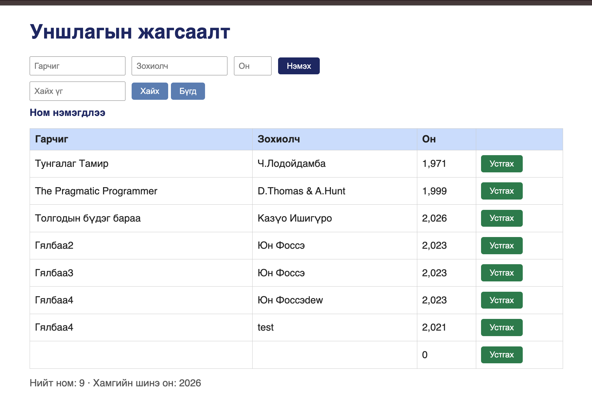

# BUG-06: Хүснэгтийн «Он» баганад он мянгатын таслалтай харагдана (1971 → «1,971»)

Орчин: Уншлагын жагсаалт v2.0, Google Chrome 154, macOS 15.6, 2026-10-16

Урьдчилсан нөхцөл: node app.js-ийг шинээр асаасан (анхны 3 ном)

## Дахин гаргах алхам

1. Хөтөчөөр http://localhost:3000 хаягийг нээнэ.
2. Хүснэгтийн «Он» баганыг харна.

Хүлээгдэж байсан: Эрүүл ухаан — оныг таслалгүйгээр «1971», «2008», «1999» гэж бичдэг.

Бодит үр дүн: «Он» баганад «1,971», «2,008», «1,999» гэж харагдана. Шинээр нэмсэн ном ч мөн адил (2023 → «2,023»). Өгөгдөл (API) зөв (`"year":1971`), зөвхөн дэлгэцэнд харуулахдаа буруу форматлаж байна.

Ноцтой байдал: Cosmetic — өгөгдөл зөв, утга нь ойлгогдохоор ч харагдах байдал буруу.

Хавсралт: screenshots/bug-05.png (UI — «Он» баганад «1,971», «1,999» харагдаж байна)

Олдсон аялал: Supermodel
