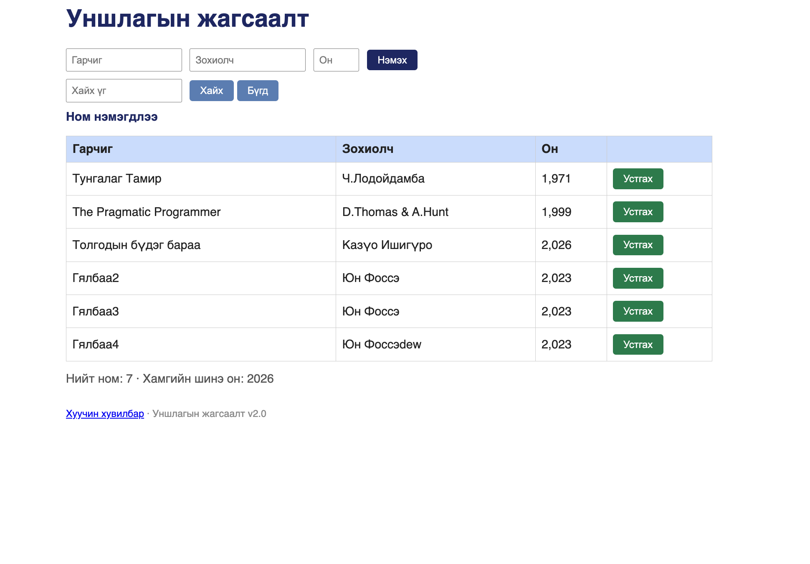

# BUG-07: Ном устгахад «Ном нэмэгдлээ» гэсэн буруу мессеж гарна

Орчин: Уншлагын жагсаалт v2.0, Google Chrome 154, macOS 15.6, 2026-10-16

Урьдчилсан нөхцөл: node app.js-ийг шинээр асаасан (анхны 3 ном)

## Дахин гаргах алхам

1. Хөтөчөөр http://localhost:3000 хаягийг нээнэ (хуудсанд ямар ч мессеж харагдахгүй байгааг шалгана).
2. «Clean Code» мөрийн «Устгах» товчийг дарна.
3. Хайх талбарын доор гарах мессежийг харна.

Хүлээгдэж байсан: Эрүүл ухаан — «Ном устгагдлаа» гэх мэт устгалтыг илэрхийлсэн мессеж гарна.

Бодит үр дүн: «Clean Code» мөр устах боловч «Ном нэмэгдлээ» гэсэн мессеж гарна.

Ноцтой байдал: Minor — үйлдэл өөрөө зөв ажиллаж байгаа ч мессеж хэрэглэгчийг төөрөгдүүлнэ (ном нэмэгдсэн гэж ойлгож болно).

Хавсралт: screenshots/bug-07.png (UI)

Олдсон аялал: Supermodel
