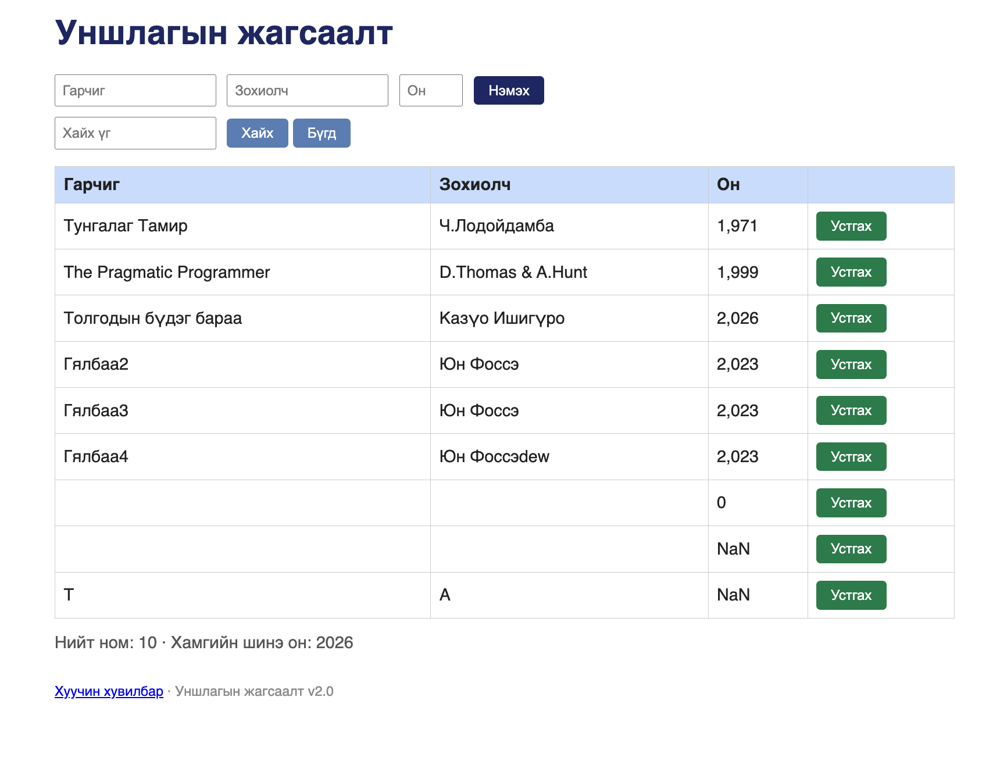
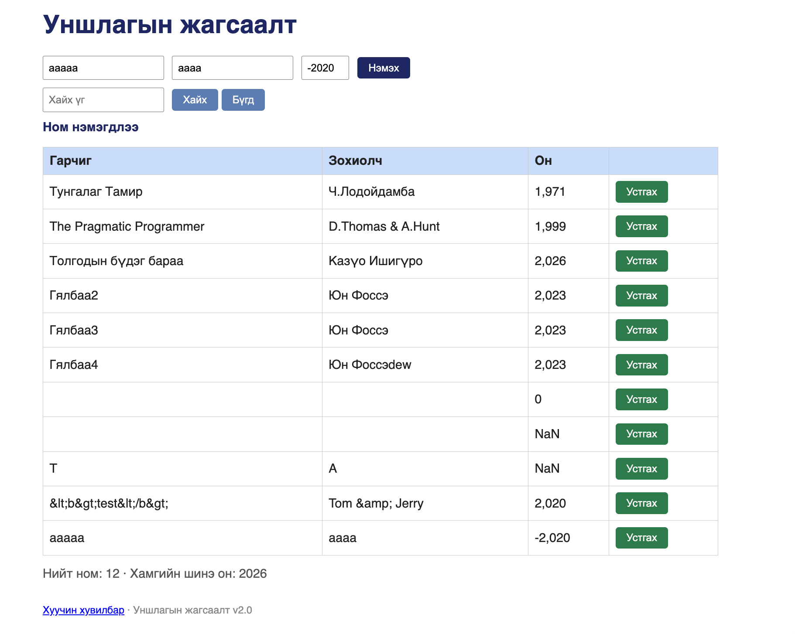
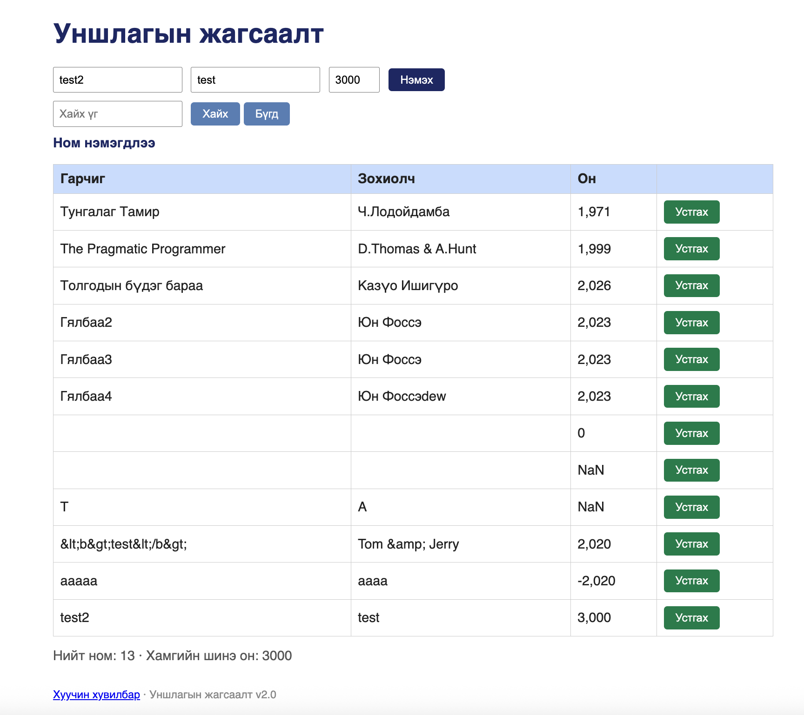

# BUG-10: Он талбарыг сервер шалгаж, хөрвүүлэхгүй хадгалдаг тул тоо биш («abc»), хүрээнээс гадуурх (-2020, 3000) он хүлээн авч, хүснэгтэд «NaN» харагдаж, статистик эвдэрнэ

Энэ тайланд нэг шалтгаантай (сервер `year`-ийг ирсэн хэлбэрээр нь шалгалтгүй хадгалдаг) гурван ажиглалтыг нэгтгэв: session-report-ийн BUG-10 (тоо биш он), BUG-12 (сөрөг/ирээдүйн он) ба BUG-17 (он number/string холилдсон, талбар байхгүй).

Орчин: Уншлагын жагсаалт v2.0, Google Chrome 154, macOS 15.6, curl 8.7.1, 2026-10-16

Урьдчилсан нөхцөл: node app.js-ийг шинээр асаасан (анхны 3 ном)

## Дахин гаргах алхам

1. Хөтөчөөр http://localhost:3000 хаягийг нээнэ.
2. Гарчиг `T`, Зохиолч `A`, Он `abc` гэж бичээд «Нэмэх» товчийг дарна.
3. Гурван талбарыг цэвэрлээд Гарчиг `aaaaa`, Зохиолч `aaaa`, Он `-2020` гэж бичээд «Нэмэх» товчийг дарна.
4. Гурван талбарыг цэвэрлээд Гарчиг `test2`, Зохиолч `test`, Он `3000` гэж бичээд «Нэмэх» товчийг дарна.
5. Хүснэгтийн «Он» багана болон доорх статистикийг харна.
6. Терминалд дараах командыг ажиллуулна (он талбаргүй ном):
   `curl -i -X POST http://localhost:3000/api/books -H 'Content-Type: application/json' -d '{"title":"X","author":"Y"}'`
7. `curl -i http://localhost:3000/api/books` командыг ажиллуулж `year` талбаруудыг харна.

Хүлээгдэж байсан: Эрүүл ухаан — Он нь тоо байх ёстой ба боломжит хүрээнд (жишээ нь 0-ээс одоогийн он хүртэл) байна. Буруу утгыг «Он буруу байна» гэх мэт мессежээр татгалзана, API нь `400 Bad Request` буцаана. Бүх номын `year` ижил төрөлтэй (number) хадгалагдана.

Бодит үр дүн:
- 2-р алхам: ном нэмэгдэж, «Он» баганад «NaN» харагдана.
- 3-р алхам: ном нэмэгдэж, «Он» баганад «-2,020» харагдана.
- 4-р алхам: ном нэмэгдэж, «Он» баганад «3,000», статистикт «Хамгийн шинэ он: 3000» болно.
- 6-р алхам: `HTTP/1.1 201 Created`, `{"result":"OK","id":7}`. Он талбаргүй ном хадгалагдаж, хуудсыг refresh хийхэд «Он» баганад «NaN» харагдана.
- 7-р алхам: анхны номд `"year":1971` (number), шинэ номд `"year":"abc"`, `"year":"-2020"`, `"year":"3000"` (string), id=7 номд `year` талбар огт байхгүй.

Ноцтой байдал: Major — буруу өгөгдөл шалгалтгүй хадгалагдаж, хүснэгт («NaN») болон статистик («Хамгийн шинэ он: 3000») буруу харагдана. API-ийн өгөгдлийн төрөл тогтворгүй тул түүнийг ашиглах клиентүүд эвдэрч болно.

Хавсралт: screenshots/bug-10.png, screenshots/bug-12-negative.png, screenshots/bug-12-future.png (UI) · evidence/bug-10-curl.txt, evidence/bug-17-curl.txt (API — `curl -i`-ийн бүтэн гаралт)

Олдсон аялал: Saboteur (API-аар «abc» илгээх), Fed-Ex (оны утгыг хүснэгт, статистик, API хүртэл дагах)
