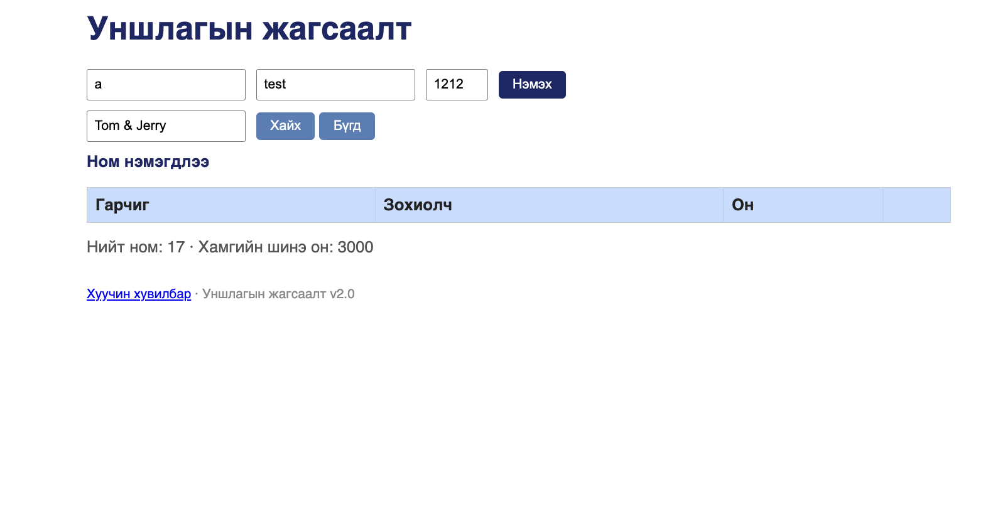

# BUG-11: <, >, & тэмдэгт агуулсан гарчиг/зохиолчийг сервер escape хийж хадгалдаг тул хүснэгтэд «Tom &amp;amp; Jerry» гэж харагдаж, тэр номыг нэрээр нь хайхад олдохгүй

Энэ тайланд нэг шалтгаантай (сервер текстийг хадгалахаасаа өмнө HTML escape хийдэг) хоёр ажиглалтыг нэгтгэв: session-report-ийн BUG-11 (давхар escape) ба BUG-16 (нэрээр нь хайхад олдохгүй).

Орчин: Уншлагын жагсаалт v2.0, Google Chrome 154, macOS 15.6, curl 8.7.1, 2026-10-16

Урьдчилсан нөхцөл: node app.js-ийг шинээр асаасан (анхны 3 ном)

## Дахин гаргах алхам

1. Хөтөчөөр http://localhost:3000 хаягийг нээнэ. Анхны «The Pragmatic Programmer» номын зохиолч «D.Thomas & A.Hunt» зөв харагдаж байгааг шалгана.
2. Гарчиг `<b>test</b>`, Зохиолч `Tom & Jerry`, Он `2020` гэж бичээд «Нэмэх» товчийг дарна.
3. Шинэ мөрийн Гарчиг, Зохиолч баганыг харна.
4. Терминалд `curl -i http://localhost:3000/api/books` командыг ажиллуулна.
5. Хөтөчид «Хайх үг» талбарт `Tom & Jerry` гэж бичээд «Хайх» товчийг дарна.
6. «Хайх үг» талбарт `amp` гэж бичээд «Хайх» товчийг дарна.

Хүлээгдэж байсан: Эрүүл ухаан — хэрэглэгчийн оруулсан текст яг оруулсан хэлбэрээрээ хадгалагдаж, харагдана: Гарчиг `<b>test</b>`, Зохиолч `Tom & Jerry` (HTML болж ажиллахгүй, текстээр). 5-р алхамд энэ ном олдоно, 6-р алхамд олдохгүй.

Бодит үр дүн:
- 3-р алхам: Гарчиг «&amp;lt;b&amp;gt;test&amp;lt;/b&amp;gt;», Зохиолч «Tom &amp;amp; Jerry» гэж харагдана. (HTML ажиллахгүй — XSS байхгүй, харин текст эвдэрнэ.)
- 4-р алхам: серверт `"title":"&lt;b&gt;test&lt;/b&gt;","author":"Tom &amp; Jerry"` гэж хадгалагдсан. Сервер хадгалахдаа нэг удаа, хөтөч харуулахдаа дахин escape хийж байна.
- 5-р алхам: хүснэгт хоосон — нэмсэн номоо нэрээр нь олохгүй.
- 6-р алхам: «Tom & Jerry» ном олдоно, хэдийгээр «amp» гэсэн үг хэрэглэгчийн оруулсан текстэд байхгүй.

Ноцтой байдал: Major — хэрэглэгчийн өгөгдөл хадгалахдаа өөрчлөгдөж (гэмтэж) байна. Үүний улмаас харагдах байдал болон хайлт хоёулаа буруу ажиллана. «&» нь зохиолчийн нэрэнд түгээмэл («D.Thomas & A.Hunt» гэх мэт).

Хавсралт: screenshots/bug-11.png, screenshots/bug-16.png, screenshots/search-tom-jerry.png (UI) · evidence/bug-11-curl.txt, evidence/bug-16-curl.txt (API — `curl -i`-ийн бүтэн гаралт)

Олдсон аялал: Fed-Ex (тусгай тэмдэгттэй текстийг оролтоос → API → хүснэгт → хайлт хүртэл дагах)
