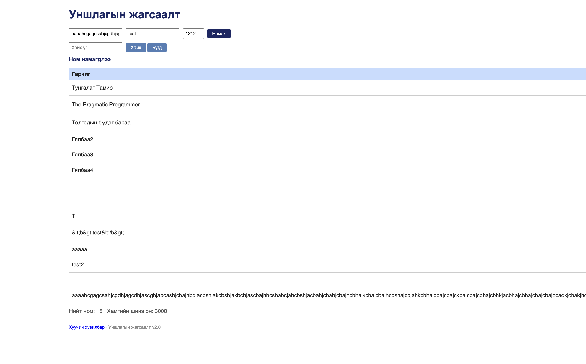

# BUG-14: Хоосон зайгүй урт гарчигтай ном нэмэхэд хүснэгт хуудаснаас хэтэрч, «Зохиолч», «Он», «Устгах» баганууд дэлгэцээс гарна

Орчин: Уншлагын жагсаалт v2.0, Google Chrome 154, macOS 15.6, 2026-10-16

Урьдчилсан нөхцөл: node app.js-ийг шинээр асаасан (анхны 3 ном). Хөтчийн цонх бүтэн дэлгэцээр.

## Дахин гаргах алхам

1. Терминалд `printf 'A%.0s' {1..300} | pbcopy` командыг ажиллуулна (хоосон зайгүй 300 «A» тэмдэгтийг clipboard руу хуулна).
2. Хөтөчөөр http://localhost:3000 хаягийг нээнэ.
3. Гарчиг талбарт Cmd+V дарж хуулсан текстийг буулгана. Зохиолч `test`, Он `2020` гэж бичнэ.
4. «Нэмэх» товчийг дарна.
5. Хүснэгтийг харна.

Хүлээгдэж байсан: Эрүүл ухаан — урт текст нүдэн дотроо мөр шилжих эсвэл «…»-ээр таслагдаж, хүснэгт хуудасны өргөнд багтана. Бүх багана харагдана.

Бодит үр дүн: Гарчиг багана маш өргөн болж, хүснэгт хуудаснаас хэтэрнэ. «Зохиолч», «Он», «Устгах» баганууд (бүх мөрийнх) дэлгэцийн баруун талаас гарч харагдахгүй болох тул хэвтээ гүйлгэх шаардлагатай болно.

Ноцтой байдал: Minor — хэвтээ гүйлгэж ашиглах боломжтой, гэвч бүх мөрийн «Устгах» товч харагдахгүй болж, хуудасны бүтэц эвдэрнэ.

Хавсралт: screenshots/bug-14.png (UI)

Олдсон аялал: Supermodel
