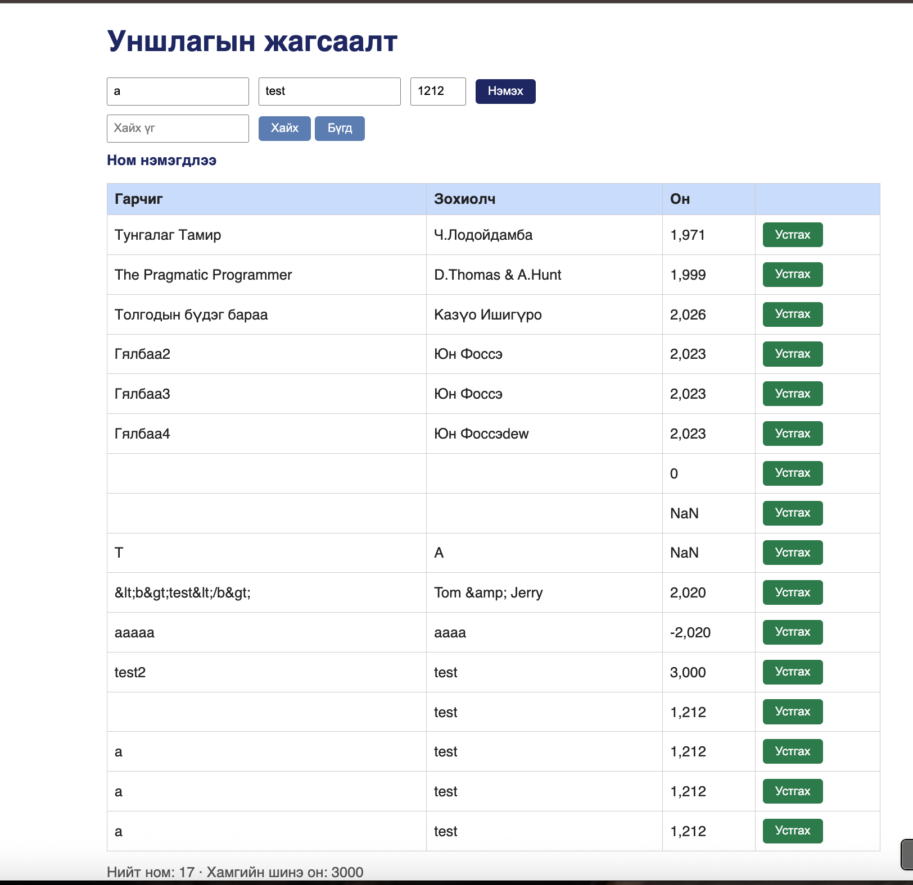

# BUG-15: «Нэмэх» товчийг дараалан дарахад ижил ном давхардаж нэмэгдэнэ

Орчин: Уншлагын жагсаалт v2.0, Google Chrome 154, macOS 15.6, 2026-10-16

Урьдчилсан нөхцөл: node app.js-ийг шинээр асаасан (анхны 3 ном)

## Дахин гаргах алхам

1. Хөтөчөөр http://localhost:3000 хаягийг нээнэ.
2. Гарчиг `a`, Зохиолч `test`, Он `1212` гэж бичнэ.
3. «Нэмэх» товчийг дараалан хурдан 3 удаа дарна.
4. Хүснэгт болон статистикийг харна.

Хүлээгдэж байсан: Эрүүл ухаан — нэг ном нэг л удаа нэмэгдэнэ: илгээж байх үед товч идэвхгүй болох, амжилттай нэмсний дараа талбарууд цэвэрлэгдэх, эсвэл ижил ном байгаа бол анхааруулах.

Бодит үр дүн: «a / test / 1,212» гэсэн ижил 3 мөр нэмэгдэж, «Нийт ном: 7» болно. Нэмсний дараа талбарууд цэвэрлэгдэхгүй, товч идэвхгүй болохгүй тул товчийг дарах бүрт ижил ном дахин нэмэгдэнэ.

Ноцтой байдал: Major — санамсаргүй давхар даралтаас болж давхардсан өгөгдөл үүсэж, статистик буруу болно. Хэрэглэгч илүүдлийг нэг нэгээр нь устгах шаардлагатай.

Хавсралт: screenshots/bug-15.png (UI)

Олдсон аялал: Saboteur
